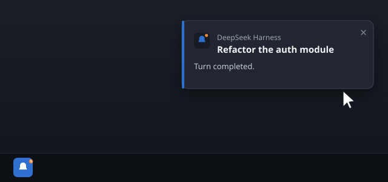
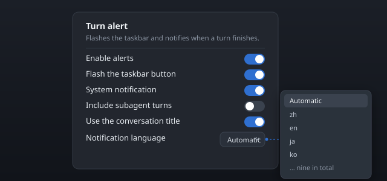

# dsh-turn-alert

English | [中文](README.zh.md)

Flash the Windows taskbar button and raise a system notification when a turn finishes, with live switches under **Settings → 回答完成提醒**.

DeepSeek Harness raises no desktop signal of its own when a reply completes. This plugin watches the Session event stream for `turn/end` and, for each turn worth interrupting you for, flashes the taskbar and raises a toast.



## Install

From a Git checkout — this is the route that works without publishing to npm:

```sh
dsh plugin --profile web add github:yurin7/dsh-turn-alert
```

Or from a local clone or the packaged tarball:

```sh
git clone https://github.com/yurin7/dsh-turn-alert.git
dsh plugin --profile web add ./dsh-turn-alert
# or
dsh plugin --profile web add ./dsh-turn-alert-1.2.1.tgz
```

Restart `dsh web` afterwards. On DSH Desktop, install from the app's own plugin page instead, so the profile the app uses is the one that changes.

Requires `dsh` 0.2.2-rc.1 or newer, on Windows.

## What it does

| Signal | How | Setting |
| --- | --- | --- |
| Taskbar flash | `FlashWindowEx` on the Desktop window, until you activate it | **闪烁任务栏图标** |
| System notification | Windows toast attributed to `com.deepseek.dsh` | **系统通知** |

Both are skipped by default for subagent turns: those are internal delegation, not a reply you are waiting on. Turn them on with **子代理也提醒**.



## Settings

Every switch is part of the plugin's Config schema and marked `volatile`, so the Settings page edits them live — no restart, and the running listener picks up the new values on the next turn.

| Option | Default | Meaning |
| --- | --- | --- |
| `enabled` | `true` | Master switch for every alert. |
| `flashTaskbar` | `true` | Flash the taskbar button. |
| `notify` | `true` | Raise the system notification. |
| `skipWhenFocused` | `false` | Stay silent while the DeepSeek Harness window is in the foreground. Off means you are alerted even while watching. |
| `alertOnError` | `true` | Also alert when a turn ends in failure. |
| `includeSubagents` | `false` | Also alert for subagent sessions. |
| `cooldownSeconds` | `3` | Minimum seconds between two alerts. |
| `language` | `auto` | Notification language: `auto`, `zh`, `en`, `ja`, `ko`, `es`, `fr`, `de`, `ru`, `pt`. |
| `titleFromSession` | `true` | Use the conversation title as the notification headline. |
| `customTitle` | empty | Custom headline. Empty keeps the conversation title or built-in copy. |
| `customBody` | empty | Custom body. Empty keeps the built-in copy. |
| `appUserModelId` | `com.deepseek.dsh` | AUMID the notification is attributed to. |
| `trace` | `false` | Write one diagnostic line per turn end to `%TEMP%\dsh-turn-alert.log`. |

### Custom text

Both the headline and the body accept a template with three placeholders:

| Placeholder | Expands to |
| --- | --- |
| `{title}` | The conversation title, empty while the session has none yet |
| `{reason}` | Why the turn ended: `completed`, `error`, `max-tokens` |
| `{session}` | The session id |

Resolution order:

1. A non-empty `customTitle` / `customBody` uses the template, with placeholders substituted
2. Otherwise the headline is the conversation title (when `titleFromSession` is on and one exists) and the body is the built-in copy
3. Otherwise both come from the built-in copy in the active language

For example, a headline of “`<title>` replied” with the reason in the body:

```yaml
- id: turn-alert
  name: dsh-turn-alert
  config:
    customTitle: '{title} replied'
    customBody: 'Ended with: {reason}'
```

### Language

The toast text and the Settings page both follow the interface language, and the two resolve it differently because they run in different processes:

- **Settings page.** Uses the Client locale service (`ctx.locale`), so it switches the moment you change the language, without a reload.
- **Toast.** The Host cannot read the browser's active locale, so it reads the locale the GUI persisted (`locale.preference` in the settings document) and otherwise falls back to the runtime locale, which mirrors the operating system. The `language` setting overrides both when it names a language.

Nine languages ship in the box: Simplified Chinese, English, Japanese, Korean, Spanish, French, German, Russian, and Brazilian Portuguese. An unmatched language falls back to English.

The same values can be written into `cordis.patch.yml`, which is what the Settings page edits:

```yaml
- id: turn-alert
  name: dsh-turn-alert
  config:
    includeSubagents: true
    cooldownSeconds: 10
```

## How it reaches the window

The Host runs as a Node-mode child of the Desktop shell and holds no Electron window handle. The plugin therefore:

1. Walks its own parent-process chain and collects the pids running the same executable as the shell. This identifies the shell regardless of process id, install path, or which child loaded the plugin.
2. Enumerates that process's visible top-level windows and calls `FlashWindowEx` with `FLASHW_ALL | FLASHW_TIMERNOFG`, so the taskbar button flashes until focus arrives rather than for a fixed count.
3. Raises the toast through the shell's registered AppUserModelID.

Win32 calls go through `koffi`, which the Desktop build ships. Toast raising needs WinRT, which a plain Node runtime cannot load, so it runs in a short-lived hidden PowerShell process. That child must stay attached: a detached, `unref`'d child exits without delivering the toast and hides its exit status. It is never awaited, so a turn never waits for it.

## Limitations

- A turn that ends in `aborted` or `interrupted` stays silent: those mean you stopped it or the process died.
- Taskbar flash and toast are Windows-only. On other platforms the plugin loads and does nothing.
- The taskbar flash needs `koffi`. The packaged Desktop ships it; a plain `dsh web` install usually does not. Without it the plugin still raises the notification and logs one warning, so the feature degrades instead of failing.
- A toast is attributed to the app AUMID, so clicking it focuses DeepSeek Harness rather than a specific conversation.
- Windows Focus Assist and notification settings can suppress the toast; the taskbar flash is an independent signal.
- `FlashWindowEx` returning `false` is not a failure: per Win32 semantics it reports that the window was not already flashing, so the return value is ignored.

## License

MIT
