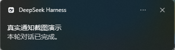
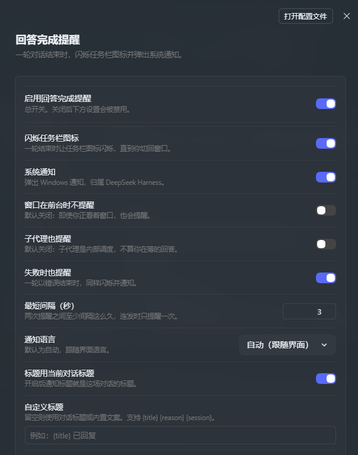

# dsh-turn-alert

English | [中文](README.zh.md)

Flash the Windows taskbar button and raise a system notification when a turn finishes, with live switches under **Settings → 回答完成提醒**.

DeepSeek Harness raises no desktop signal of its own when a reply completes. This plugin watches the Session event stream for `turn/end` and, for each turn worth interrupting you for, flashes the taskbar and raises a toast.



## Install

From a Git checkout — this is the route that works without publishing to npm:

```sh
dsh plugin --profile web add github:yurin7/dsh-turn-alert
```

Or from a local clone or the packaged tarball:

```sh
git clone https://github.com/yurin7/dsh-turn-alert.git
dsh plugin --profile web add ./dsh-turn-alert
# or
dsh plugin --profile web add ./dsh-turn-alert-1.2.1.tgz
```

Restart `dsh web` afterwards. On DSH Desktop, install from the app's own plugin page instead, so the profile the app uses is the one that changes.

Requires `dsh` 0.2.2-rc.1 or newer, on Windows.

## What it does

| Signal | What you see | Setting |
| --- | --- | --- |
| Taskbar flash | The app button keeps flashing until you switch back to the window | **闪烁任务栏图标** |
| System notification | A Windows notification from DeepSeek Harness | **系统通知** |

Both are skipped by default for subagent turns: those are internal delegation, not a reply you are waiting on. Turn them on with **子代理也提醒**.



## Settings

Open **Settings → 回答完成提醒**. Turning the master switch off disables everything below it. Changes apply immediately — no restart.

| Option | Default | Meaning |
| --- | --- | --- |
| `enabled` | `true` | Master switch for every alert. |
| `flashTaskbar` | `true` | Flash the taskbar button. |
| `notify` | `true` | Raise the system notification. |
| `skipWhenFocused` | `false` | Stay silent while the DeepSeek Harness window is in the foreground. Off means you are alerted even while watching. |
| `alertOnError` | `true` | Also alert when a turn ends in failure. |
| `includeSubagents` | `false` | Also alert for subagent sessions. |
| `cooldownSeconds` | `3` | Minimum seconds between two alerts. |
| `language` | `auto` | Notification language: `auto`, `zh`, `en`, `ja`, `ko`, `es`, `fr`, `de`, `ru`, `pt`. |
| `titleFromSession` | `true` | Use the conversation title as the notification headline. |
| `customTitle` | empty | Custom headline. Empty keeps the conversation title or built-in copy. |
| `customBody` | empty | Custom body. Empty keeps the built-in copy. |
| `appUserModelId` | `com.deepseek.dsh` | The app identity the notification is shown under. |
| `trace` | `false` | Write one diagnostic line per turn end to `%TEMP%\dsh-turn-alert.log`. |

### Custom text

Both the headline and the body accept a template with three placeholders:

| Placeholder | Expands to |
| --- | --- |
| `{title}` | The conversation title, empty while the session has none yet |
| `{reason}` | Why the turn ended: `completed`, `error`, `max-tokens` |
| `{session}` | The session id |

Resolution order:

1. A non-empty `customTitle` / `customBody` uses the template, with placeholders substituted
2. Otherwise the headline is the conversation title (when `titleFromSession` is on and one exists) and the body is the built-in copy
3. Otherwise both come from the built-in copy in the active language

For example, a headline of “`<title>` replied” with the reason in the body:

```yaml
- id: turn-alert
  name: dsh-turn-alert
  config:
    customTitle: '{title} replied'
    customBody: 'Ended with: {reason}'
```

### Language

The toast text and the Settings page both follow the interface language, and the two resolve it differently because they run in different processes:

- **Settings page.** Uses the Client locale service (`ctx.locale`), so it switches the moment you change the language, without a reload.
- **Toast.** The Host cannot read the browser's active locale, so it reads the locale the GUI persisted (`locale.preference` in the settings document) and otherwise falls back to the runtime locale, which mirrors the operating system. The `language` setting overrides both when it names a language.

Nine languages ship in the box: Simplified Chinese, English, Japanese, Korean, Spanish, French, German, Russian, and Brazilian Portuguese. An unmatched language falls back to English.

The same values can be written into `cordis.patch.yml`, which is what the Settings page edits:

```yaml
- id: turn-alert
  name: dsh-turn-alert
  config:
    includeSubagents: true
    cooldownSeconds: 10
```

## License

MIT
