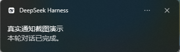
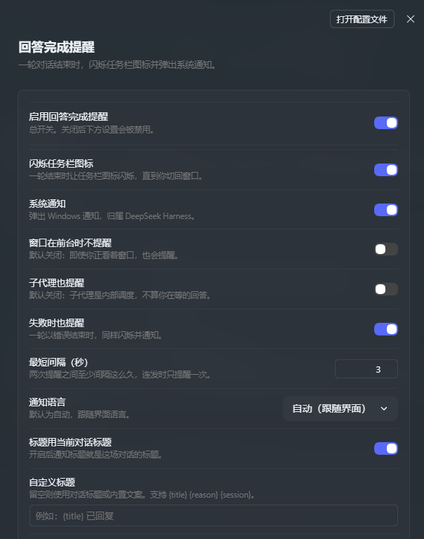

# dsh-turn-alert

[English](README.md) | 中文

一轮对话结束时闪烁 Windows 任务栏图标并弹出系统通知，开关在 **设置 → 回答完成提醒**。

DSH 在回答完成时本身没有任何桌面提示。本插件监听 Session 事件流里的 `turn/end`，对值得打扰你的回合闪烁任务栏并弹出通知。



## 安装

从 Git 安装 —— 不发布 npm 也能用的方式：

```sh
dsh plugin --profile web add github:yurin7/dsh-turn-alert
```

或者从本地克隆、打包好的 tarball 安装：

```sh
git clone https://github.com/yurin7/dsh-turn-alert.git
dsh plugin --profile web add ./dsh-turn-alert
# 或
dsh plugin --profile web add ./dsh-turn-alert-1.2.1.tgz
```

装完重启 `dsh web`。DSH Desktop 请在应用自己的插件页安装，否则改的不是应用正在用的 profile。

要求 `dsh` 0.2.2-rc.1 及以上，仅支持 Windows。

## 它做什么

| 提醒方式 | 你会看到什么 | 开关 |
| --- | --- | --- |
| 任务栏闪烁 | 应用按钮持续闪烁，直到你切回窗口 | **闪烁任务栏图标** |
| 系统通知 | 一条来自 DeepSeek Harness 的 Windows 通知 | **系统通知** |



子代理回合默认两种都不提醒：那是内部调度，不是你在等的回答。需要时用 **子代理也提醒** 打开。

## 设置

打开 **设置 → 回答完成提醒**。关闭顶部的总开关后，下面所有选项都会禁用。改完即时生效，不用重启。

| 配置项 | 默认 | 含义 |
| --- | --- | --- |
| `enabled` | `true` | 总开关。 |
| `flashTaskbar` | `true` | 闪烁任务栏图标。 |
| `notify` | `true` | 弹出系统通知。 |
| `skipWhenFocused` | `false` | 窗口在前台时不提醒。默认关闭，即你看着也提醒。 |
| `alertOnError` | `true` | 一轮以错误结束时也提醒。 |
| `includeSubagents` | `false` | 子代理会话也提醒。 |
| `cooldownSeconds` | `3` | 两次提醒的最短间隔（秒）。 |
| `language` | `auto` | 通知语言：`auto`、`zh`、`en`、`ja`、`ko`、`es`、`fr`、`de`、`ru`、`pt`。 |
| `titleFromSession` | `true` | 通知标题用当前这场对话的标题。 |
| `customTitle` | 空 | 自定义标题。留空则用对话标题或内置文案。 |
| `customBody` | 空 | 自定义正文。留空则用内置文案。 |
| `appUserModelId` | `com.deepseek.dsh` | 通知显示在哪个应用身份下。 |
| `trace` | `false` | 每次回合结束往 `%TEMP%\dsh-turn-alert.log` 写一行诊断。 |

### 自定义提醒内容

标题和正文都可以自定义，模板支持三个占位符：

| 占位符 | 含义 |
| --- | --- |
| `{title}` | 当前对话标题（会话还没有标题时为空） |
| `{reason}` | 本轮结束原因：`completed`、`error`、`max-tokens` |
| `{session}` | 会话 id |

取值优先级：

1. `customTitle` / `customBody` 非空 → 用模板（占位符会被替换）
2. 否则标题用对话标题（`titleFromSession` 开启且有标题时），正文用内置文案
3. 再否则用对应语言的内置文案

例如让标题显示「<对话标题> 已回复」、正文带上原因：

```yaml
- id: turn-alert
  name: dsh-turn-alert
  config:
    customTitle: '{title} 已回复'
    customBody: '结束原因：{reason}'
```

### 语言

通知文字和设置页都跟随界面语言，但两者取值方式不同，因为它们跑在不同进程里：

- **设置页**：走 Client 端的 locale 服务（`ctx.locale`），所以切换语言时立即重绘，不用刷新。
- **通知**：Host 读不到浏览器当前语言，于是读 GUI 持久化的 `locale.preference`，没有则回退到运行时 locale（跟随操作系统）。`language` 指定语言时优先于这两者。

内置九种语言：简体中文、英语、日语、韩语、西班牙语、法语、德语、俄语、巴西葡萄牙语。匹配不到时回退英语。

设置页改的就是 `cordis.patch.yml`，也可以直接手写：

```yaml
- id: turn-alert
  name: dsh-turn-alert
  config:
    includeSubagents: true
    cooldownSeconds: 10
```

## 许可

MIT
